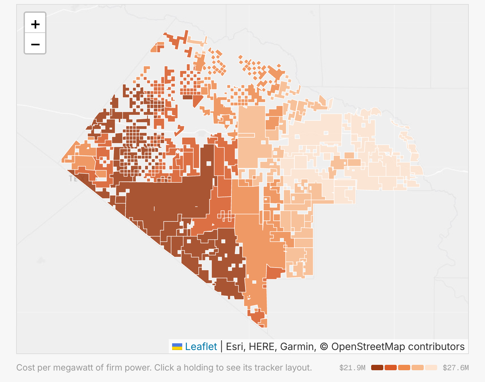

# OGPSE — Off-Grid Power Site Evaluator

For every land holding over 2,000 acres in Pecos County, Texas: how much 24/7 solar + battery power an off-grid data center campus could get there, and at what cost per firm MW.

**[ogpse.sethlupo.com](https://ogpse.sethlupo.com)** · [REPORT.md](REPORT.md)



## Result

- **198 sites** in Pecos County could host about 32 GW of firm power.
- Capital cost runs from **$21.9 M to $27.6 M per firm MW** (26% spread). Annual sunshine differs only 6.7% across the same sites.
- The spread comes from weather extremes, not averages. Sizing for annual energy plus one night of storage keeps the lights on only **70%** of hours. Reaching 99.9% takes 3× the solar and 48 h of storage, about **3.3×** the cost. The worst 5 days in 25 years delivered 14% of normal solar energy.
- Land is about 0.3% of cost. It decides how many megawatts a site can host, not what each one costs.

| Validation | Result |
|---|---|
| Layout vs 10 unseen built plants (USPVDB) | 17.7% error (naive rule 18.0%) |
| Solar output vs NREL SAM, 25 years | 0.16% |
| 99.9% uptime re-check, all 198 designs, 25 years hourly | all pass |

## Run

```sh
uv sync
printf "NREL_DEVELOPER_API_KEY=<key>\nNREL_EMAIL=<email>\n" > .env   # free key: developer.nlr.gov/signup
set -a; . ./.env; set +a
make all    # feasibility → run → validate → summary
make test
```

The first run downloads about 1.5 GB of public data; the NSRDB step (1,250 requests) dominates and takes roughly 1.5 h. Every download is cached and recorded in `data/manifest.csv` with its URL and SHA-256. Later runs are offline and take about 20 minutes on 8 cores. All assumptions live in [`config.yaml`](config.yaml).

## Layout

```
config.yaml            every assumption and data source
src/ogpse/
  sources.py           cached, provenance-logged downloads
  parcels.py           parcels → ownership holdings → sites
  terrain.py           3DEP DEM tiles, slopes
  hazards.py           NWI wetlands, FEMA flood zones and panels
  layout.py            buildable mask, tracker rows
  weather.py           NSRDB hourly, 25 years
  equipment.py         CEC module and inverter
  solar.py             pvlib single-axis tracker model
  sizing.py            hourly dispatch, uptime, PV bisection, design search
  costs.py             NREL ATB 2025
  firm.py              per-weather-node designs
  pipeline.py          layouts × designs → ranking, map data
  validate.py          the three checks
  summary.py           headline numbers for the page
web/                   static map (Leaflet), deployable as-is
results/               sites.csv, feasibility.csv, validation outputs
```
